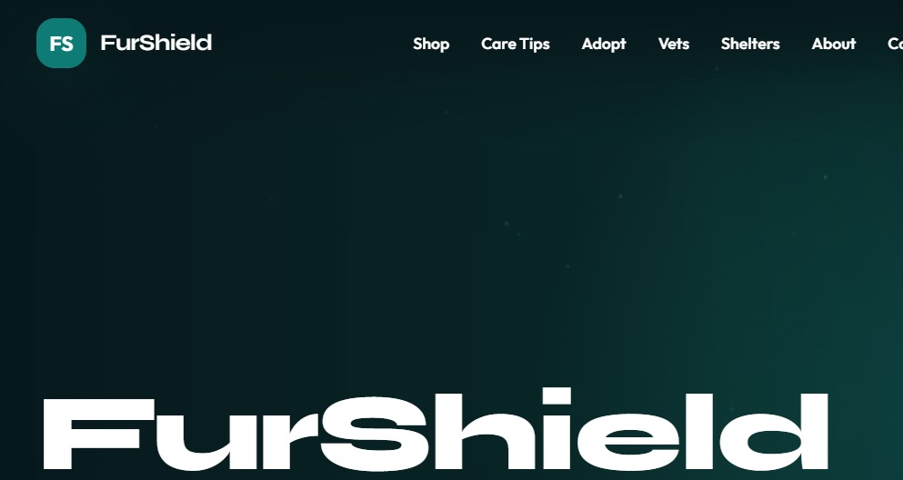
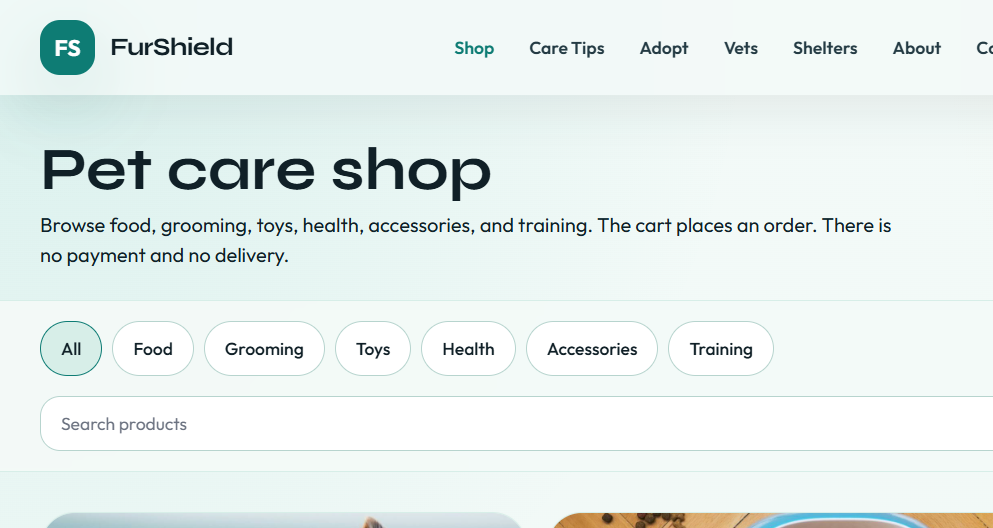

# FurShield

**Every Paw/Wing Deserves a Shield of Love**

FurShield is the Aptech pet-care platform. An owner keeps one record for each pet. Veterinarians and shelters work from that same record. The shop places an order. There is no payment gateway and no delivery.

Sample accounts, pets, and listings in the seeder are demonstration data. They are not real patients, customers, or reviews.

## Stack

- PHP 8.2 and Laravel 12
- SQLite by default, MySQL when you switch `DB_CONNECTION`
- Blade, Tailwind CSS 3, Alpine.js 3, and Vite
- Vanilla Motion for animation, with `prefers-reduced-motion` respected
- Leaflet for “Vets near me”, loaded in its own bundle

## Quick start

From this folder:

```bash
composer install
cp .env.example .env
php artisan key:generate
# SQLite file: database/database.sqlite (create it if it is missing)
php artisan migrate:fresh --seed
php artisan storage:link
npm install
npm run build
php artisan serve
```

Open `http://127.0.0.1:8000`.

`migrate:fresh --seed` replaces the database. Use it for a clean demo. Do not run it against a database you need to keep.

`.env.example` ships with `APP_DEBUG=false`. Leave it false for any shared or graded deploy. A private local demo may set `APP_DEBUG=true` while `APP_ENV=local`.

### MySQL

```env
DB_CONNECTION=mysql
DB_HOST=127.0.0.1
DB_PORT=3306
DB_DATABASE=furshield
DB_USERNAME=root
DB_PASSWORD=
```

Then run `php artisan migrate:fresh --seed`.

## Credentials

Every demo account uses the password `password`.

| Role | Name | Email |
|------|------|-------|
| Admin | FurShield Admin | admin@furshield.test |
| Owner | Ayesha Khan | owner@furshield.test |
| Owner | Bilal Ahmed | owner.bilal@furshield.test |
| Owner | Fatima Noor | owner.fatima@furshield.test |
| Veterinarian | Dr. Hassan Ali | vet@furshield.test |
| Veterinarian | Dr. Noor Fatima | vet.noor@furshield.test |
| Veterinarian | Dr. Omar Siddiqui | vet.omar@furshield.test |
| Veterinarian | Dr. Hina Qureshi | vet.hina@furshield.test |
| Shelter | Paw Haven Shelter | shelter@furshield.test |
| Shelter | Creek Side Shelter | shelter.creek@furshield.test |

## Features

- Registration for owners, veterinarians, and shelters, with role dashboards and role middleware
- Several pets per owner, health timelines, insurance uploads, and a public Pet ID that hides the private record until the owner shares fields
- Health reminders for due and overdue care, plus in-app notifications
- Appointment booking from a veterinarian’s open slots, with pending, approved, rescheduled, completed, and cancelled visits
- Vets near me, using each clinic’s coordinates and hours
- Symptom check and emergency mode at `/triage`
- Shop, cart, and checkout with stock checks. The cart places an order. Nothing is charged and nothing is shipped
- Care articles
- Adoption board with available, pending, and adopted listings, plus shelter care notes and adopter interest
- Admin overview: counts, charts, account search, and CSV export
- Command palette (Ctrl+K or Cmd+K) and a shared shell for the public site and the dashboards
- Optional FurShield Assistant for signed-in owners, bottom-right. Set `FURSHIELD_ASSISTANT_ENABLED=true` and either `FURSHIELD_ASSISTANT_API_KEY` or `GEMINI_API_KEY` in `.env`. The key never reaches the browser. Gemini is used through Google’s OpenAI-compatible endpoint. Answers use that owner’s pet species, age, allergies, and recent records. The assistant does not diagnose and does not give medication doses. Red-flag symptoms show the emergency check.
- Gmail SMTP for password reset and email verification, and Google sign-in. Setup is in `EMAIL_SETUP.md`. A new Google account joins as an owner. An existing email signs in to that account.

The component style guide at `/dev/ui` is registered only when `APP_ENV=local`.

## Screenshots

Home and the shop, signed out:





The same folder is the place for the rest of the demo script. Add these after a fresh seed if a slide deck needs them:

| File | What it shows |
|------|----------------|
| `docs/screenshots/adopt.png` | Adoption deck |
| `docs/screenshots/triage.png` | Symptom check |
| `docs/screenshots/owner-dashboard.png` | Ayesha Khan’s dashboard, with due and overdue care |
| `docs/screenshots/vets.png` | Vets near me |

Photos in the product, pet, adoption, and care records are the files in `public/images`. The About page uses `public/images/catalog-two-dogs.jpg`.

## Five-minute demo

Start from a freshly seeded database, signed out, at `http://127.0.0.1:8000`.

1. **0:00 — Public site.** Scroll the home page. Open the shop and show a product photo and the “no payment, no delivery” line. Open Adoption and flip one card. Open Symptom check, choose a dog and “Difficulty breathing”, and show the emergency result. Do not invent a clinic phone.
2. **1:30 — Owner.** Sign in as `owner@furshield.test` / `password`. On the dashboard, point at Milo’s upcoming care and Luna’s overdue care. Open Pets and show Milo, Luna, and Pip. Open Appointments and name one pending visit and one completed visit. Open the bell and read the sample reminders.
3. **3:00 — Shop.** Add the Feather Wand Toy. Open the cart and place the order. The confirmation says payment and delivery are outside FurShield. Orders already lists the earlier Clicker Training Kit.
4. **3:45 — Veterinarian.** Sign out. Sign in as `vet@furshield.test` / `password`. Open Appointments and show today’s queue beside the pending Milo visit. Open the clinic profile and show the weekday slots.
5. **4:20 — Shelter and admin.** Sign in as `shelter@furshield.test` / `password`. Show Buddy (available), Fig (pending), and Fatima’s sample interest. Sign in as `admin@furshield.test` / `password` and show the overview counts. Stop at five minutes.

## Out of scope

The SRS leaves out a payment gateway, physical delivery, and veterinarian license checks. Those are not in this build. The assistant is optional and is not a diagnosis or a prescription.
